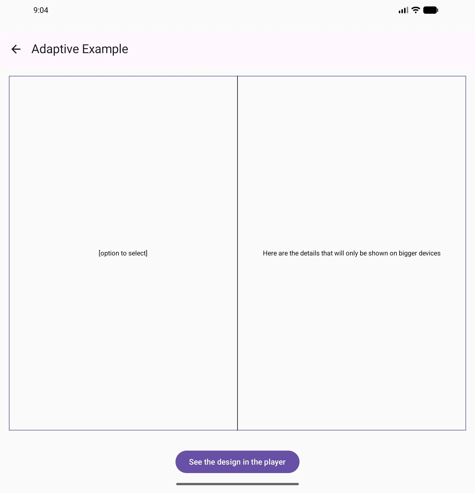
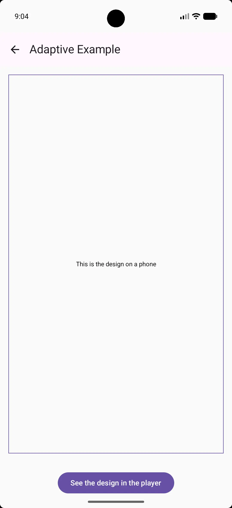

# Adaptive Example

An adaptive example that shows the intended method to handle different screen sizes (adaptive concept).
It showcases the following in the creator: **RemoteFitBox**.

 Adaptive Example for unfolded

 Adaptive Example for phone

_Some notes_:

- **RemoteFitBox** works as such: it chooses the 1st child that fits; the intention is to provide all the different
  composables from the largest to the smallest, unlike other adaptive methods where one can check the class of the
  device (phone, tablet/fold, etc.). The composables need to allocate a minimum size and not fill the parent, in order
  to let **RemoteFitBox** pick the one that fits; the fallback, i.e. the smallest, does not need to.
- As version 1.0.0-alpha23 introduced a new RemoteColor extension (_@ColorInt.rc_), it is used here as an example; also,
  it is more efficient than using the Compose Color's _.rc_ extension since RemoteColor needs the color's argb value.